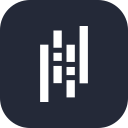
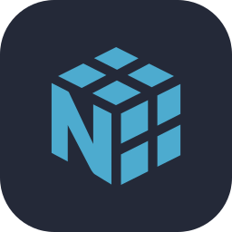
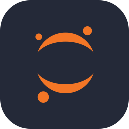
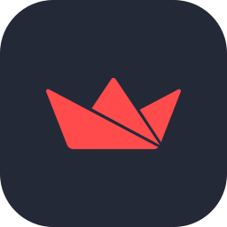

<h1 align="center">Hi, I'm Aries 👋</h1>

  

  
  
  
  
  

  

---

I'm an Informatics student at **Universitas Islam Indonesia** working where **AI, data, and web development** meet.
Here on GitHub, I build things end to end: fine-tuning **small language models**, analysing data, and shipping **full-stack web apps** that real people use.

### What Drives My Work

I like taking an idea from a notebook all the way to something people can open in a browser.
Right now that means my thesis: **fine-tuning a small language model for an offline Indonesian medical chatbot**, so useful health information doesn't depend on a fast connection.
Outside research, I care about **technology that serves communities**, like mosques that want transparent finances and neighbourhoods that want a simple, honest portal.

### Tech I Use

<h4 align="center">💻 Languages</h4>
<table align="center">
<tr>
<td align="center" width="96"> <b>Python</b></td>
<td align="center" width="96"> <b>TypeScript</b></td>
<td align="center" width="96"> <b>JavaScript</b></td>
<td align="center" width="96"> <b>Java</b></td>
</tr>
</table>

<h4 align="center">🧠 AI & Data Science</h4>
<table align="center">
<tr>
<td align="center" width="96"> <b>PyTorch</b></td>
<td align="center" width="96"> <b>TensorFlow</b></td>
<td align="center" width="96"> <b>Hugging Face</b></td>
<td align="center" width="96"> <b>scikit-learn</b></td>
<td align="center" width="96"> <b>Pandas</b></td>
<td align="center" width="96"> <b>NumPy</b></td>
<td align="center" width="96"> <b>Jupyter</b></td>
<td align="center" width="96"> <b>Streamlit</b></td>
</tr>
</table>

<h4 align="center">🌐 Web Development</h4>
<table align="center">
<tr>
<td align="center" width="96"> <b>React</b></td>
<td align="center" width="96"> <b>Next.js</b></td>
<td align="center" width="96"> <b>Tailwind</b></td>
<td align="center" width="96"> <b>Node.js</b></td>
<td align="center" width="96"> <b>Django</b></td>
<td align="center" width="96"> <b>Flask</b></td>
</tr>
</table>

<h4 align="center">🗃️ Databases</h4>
<table align="center">
<tr>
<td align="center" width="96"> <b>MySQL</b></td>
<td align="center" width="96"> <b>PostgreSQL</b></td>
<td align="center" width="96"> <b>MongoDB</b></td>
<td align="center" width="96"> <b>Firebase</b></td>
<td align="center" width="96"> <b>Supabase</b></td>
</tr>
</table>

<h4 align="center">⚙️ DevOps & Tools</h4>
<table align="center">
<tr>
<td align="center" width="96"> <b>Git</b></td>
<td align="center" width="96"> <b>GitHub</b></td>
<td align="center" width="96"> <b>Docker</b></td>
<td align="center" width="96"> <b>Vercel</b></td>
<td align="center" width="96"> <b>Colab</b></td>
<td align="center" width="96"> <b>VS Code</b></td>
<td align="center" width="96"> <b>Figma</b></td>
</tr>
</table>

### What I'm Building

#### 🧠 AI & Research
<ul>
  <li><a href="https://github.com/AriesDjae/Fine-Tune-SLM"><b>Fine-Tune-SLM</b></a>: an offline Indonesian medical chatbot built on a fine-tuned small language model, with an interface for testing it · <a href="https://evaluasi-chatbot-medis.vercel.app">evaluation dashboard ↗</a></li>
  <li><a href="https://github.com/AriesDjae/Chatbot-INF"><b>Chatbot-INF</b></a>: a chatbot experiment for the Informatics department</li>
</ul>

#### 🌐 Web, Live on Vercel
<ul>
  <li><a href="https://github.com/AriesDjae/AmanahMasjid"><b>AmanahMasjid</b></a>: a platform that makes mosque finances transparent · <a href="https://amanah-masjid.vercel.app">live ↗</a></li>
  <li><a href="https://github.com/AriesDjae/umkm-sanggrahan"><b>UMKM Sanggrahan</b></a>: an online storefront for small local businesses in Kampung Sanggrahan · <a href="https://umkm-sanggrahan.vercel.app">live ↗</a></li>
  <li><a href="https://github.com/AriesDjae/profil-rw-sanggrahan"><b>Profil RW Sanggrahan</b></a>: a neighbourhood portal where financial reports go through step-by-step approval · <a href="https://profil-rw-sanggrahan.vercel.app">live ↗</a></li>
  <li><a href="https://github.com/AriesDjae/Agrisense"><b>Agrisense</b></a>: a smart agriculture web app · <a href="https://agrisense-bice-kappa.vercel.app">live ↗</a></li>
</ul>

#### 📊 Data Analysis
<ul>
  <li><a href="https://github.com/AriesDjae/Coffee-sales-forecasting"><b>Coffee Sales Forecasting</b></a>: time-series forecasting on sales data</li>
  <li><a href="https://github.com/AriesDjae/Analisis_bisnis_pariwisata_BI"><b>Tourism Business Analysis</b></a>: business intelligence for tourism data</li>
  <li><a href="https://github.com/AriesDjae/AnalizeSentiment-ACShadows"><b>Sentiment Analysis: AC Shadows</b></a>: an NLP sentiment study of public reviews</li>
</ul>

### Beyond the Code

When I'm not building, I'm probably:
- Helping students in the **Cyber Lab** at UII as a lab assistant
- Running practicum sessions as a **teaching assistant** for web and mobile programming
- Building digital tools for the community I worked with during **KKN** in Kampung Sanggrahan
- Exploring a new model, dataset, or framework that will likely become my next repo

---

<b>📈 GitHub Stats</b>

 

  
  

Self-hosted on my own Vercel instance of <a href="https://github.com/AriesDjae/github-readme-stats">github-readme-stats</a>.

